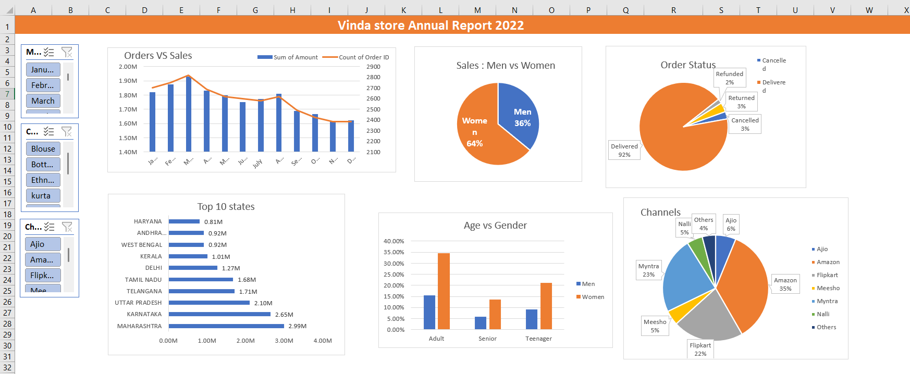

# Vrinda-Store-Sales-Analysis
An interactive Excel dashboard analyzing Vrinda Store's 2022 e-commerce sales performance, customer behavior, and business insights.
# 🛍️ Vrinda Store – Annual Sales Analysis Dashboard (2022)

### Business Analysis | Data Analytics | Microsoft Excel

An interactive Excel dashboard designed to analyze e-commerce sales performance, customer demographics, order fulfilment, and sales channel performance for Vrinda Store.

---

## 📌 Project Overview

This project analyzes Vrinda Store's 2022 e-commerce sales data to identify business trends, understand customer purchasing patterns, evaluate sales channel performance, and monitor order fulfilment.

Using Microsoft Excel, I transformed raw transactional data into an interactive dashboard that helps stakeholders understand business performance and make data-driven decisions.

## Business Objectives

- Analyze overall sales and order performance.
- Understand purchasing patterns across customer genders and age groups.
- Identify monthly sales trends and fluctuations.
- Evaluate sales performance across different Indian states.
- Compare the performance of different e-commerce sales channels.
- Monitor order delivery, cancellation, return, and refund status.
- Identify potential opportunities for business improvement.

## Dashboard Preview



## Key Performance Indicators

| Metric | Result |
|---|---:|
| Total Sales Amount | ₹21,176,377 |
| Total Order Records | 31,047 |
| Delivered Order Records | 28,641 |
| Delivery Rate | 92.25% |
| Women's Sales Contribution | 64.04% |

## Analysis & Key Findings

### 1. Monthly Sales Analysis
- March recorded the highest monthly sales at ₹1,928,066.
- November recorded the lowest monthly sales at ₹1,615,356.
- Sales performance varied throughout the year.

### 2. Gender-Based Sales Analysis
- Women contributed approximately 64.04% of total sales.
- Men contributed approximately 35.96% of total sales.
- Women's products represented the larger sales segment.

### 3. Sales Channel Analysis
- Amazon accounted for approximately 35.48% of order records.
- Myntra contributed approximately 23.36%.
- Flipkart contributed approximately 21.59%.
- The three leading channels represented the majority of order records.

### 4. Order Status Analysis
- Delivered: 28,641 records.
- Returned: 1,045 records.
- Cancelled: 844 records.
- Refunded: 517 records.

### 5. Geographical Sales Analysis
- Maharashtra ranked first in sales with ₹2,990,221.
- Karnataka ranked second with ₹2,646,358.
- Uttar Pradesh ranked third with ₹2,104,659.

## Business Recommendations

Based on the analysis, the following opportunities could be investigated:

1. Explore opportunities to strengthen women's product categories, which account for the largest sales contribution.
2. Investigate monthly sales fluctuations to understand seasonal demand and promotional opportunities.
3. Evaluate the performance and profitability of individual sales channels to optimize channel strategy.
4. Analyze return, cancellation, and refund patterns to identify potential fulfilment issues.
5. Study high-performing geographical markets to identify opportunities for regional growth.

## Tools & Technologies

- Microsoft Excel
- Pivot Tables
- Pivot Charts
- Excel Formulas
- Data Cleaning and Preparation
- Interactive Slicers
- Data Visualization
- KPI Analysis

## Dataset Information

The dataset contains 31,047 transactional records and includes fields such as:

- Order ID
- Customer ID
- Gender and Age
- Order Date and Month
- Order Status
- Sales Channel
- Product Category
- Quantity and Sales Amount
- Shipping City and State

Currency: Indian Rupee (INR)

## Repository Structure

```text
Vrinda-Store-Sales-Analysis/
│
├── images/
│   ├── dashboard-overview.png
│   ├── sales-analysis.png
│   └── customer-analysis.png
│
├── data/
│   └── sample-dataset.xlsx
│
├── Vrinda-Store-Dashboard.xlsx
├── Project-Report.pdf
└── README.md
```

## Skills Demonstrated

- Business Analysis
- Exploratory Data Analysis
- Data Cleaning
- KPI Development and Monitoring
- Customer Segmentation
- Sales Performance Analysis
- Trend Analysis
- Business Insights and Recommendations
- Data Visualization
- Microsoft Excel

## Conclusion

This project demonstrates how Microsoft Excel can transform raw e-commerce data into meaningful business insights.

Through sales analysis, customer segmentation, geographical analysis, and order fulfilment monitoring, the dashboard provides a structured view of business performance and highlights opportunities for further investigation and improvement.

**Project Category:** Business Analysis & Data Analytics  
**Reporting Period:** 2022  
**Tool:** Microsoft Excel  
**Dataset:** Vrinda Store E-commerce Sales Data
